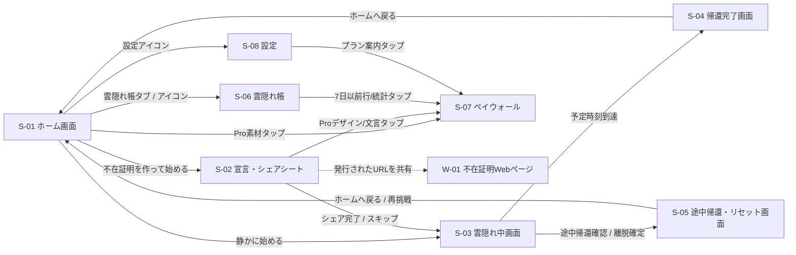

# UX フロー・画面仕様書

本ドキュメントは『雲隠れ（Kumogakure）』の全画面（iOS アプリ 8 画面 + 不在証明 Web ページ 1 系統）の遷移・情報設計・操作・エッジケースを定義します。

---

## 1. コア UX フローと画面遷移図

### 基本原則
- **3 秒開始**: オンボーディングやアカウント登録を挟まず、初回起動から S-01（ホーム）を表示し、デフォルト設定のまま 1〜2 タップで開始できること。
- **シェアシート競合の回避**: S-02 で `UIActivityViewController`（OS 標準シェアシート）を開いている間は離脱検知を無効化し、シートを閉じて S-03 へ遷移した直後からタイマーおよび離脱検知を開始する。

---

## 2. 画面詳細仕様

### S-01: ホーム画面

- **役割**: 雲隠れの時間・目的・風景・環境音を選び、すぐに雲隠れを開始するメイン画面。
- **表示要素**:
  1. ヘッダー: アプリタイトル「雲隠れ」、右上に「雲隠れ帳（履歴）」アイコン・設定（歯車）アイコン。
  2. 静かな連帯感バッジ:
     - サーバー取得 `active_count > 0` の場合: 「現在、**{active_count} 人** が雲隠れしています」
     - `active_count == 0` または取得中/オフライン（キャッシュなし）の場合: 「いま、穏やかな静寂が広がっています」
  3. 風景プレビュー背景: 現在選択中の `theme_id` の薄暗いプレビューを背面に敷き、薄い霧が漂う。
  4. **時間選択**:
     - チップボタン: `15分` / `30分`（初期選択）/ `1時間` / `2時間` / `明日の朝まで` / `カスタム`
     - `明日の朝まで` 計算規則: 設定画面（S-08）で設定した目標朝時刻（デフォルト `07:00`、選択範囲 `05:00`〜`10:00`）を使用。「現在時刻 + 15 分 <= 当日の目標朝時刻」の場合は当日朝、それ以降は翌日朝を目標時刻とし、`15` 分〜`720` 分（12 時間）にクランプした値を採用する。昼間等で 12 時間上限に丸められた場合を含め、チップ直下または予定表示に実際の帰還予定時刻（例: `翌 07:00 頃帰還`／`上限12時間：03:00 頃帰還`）を必ず明示する。
     - `カスタム`: 15 分〜720 分（15 分刻み）のドラムピッカーモーダルを開く。
  5. **目的選択（`purpose_id`）**:
     - チップ: `ただ休む`（初期） / `読書` / `睡眠` / `集中・作業` / `散歩・入浴` / `自由に入力（Pro 鍵）`
  6. **風景・環境音セレクタ**:
     - 横スクロールカードで `theme_id`（4 種）と `sound_id`（無音 + 3 種）を選択。Pro 限定素材には小さな鍵アイコン＋「隠者」ラベルを表示し、タップで S-07 へ遷移。環境音タップ時は 2 秒間の短いプレビュー再生可。
  7. **CTA ボタン（下部固定）**:
     - プライマリ: **「不在証明を作って雲隠れ」** → S-02 へ
     - セカンダリ（テキストリンク風）: **「シェアせず静かに始める」** → API 非公開登録（非同期・失敗時も進行）のうえ即座に S-03 へ
- **状態とエッジケース**:
  - 前回セッション終了前にアプリがタスクキルされていた場合、起動直後に復帰判定を行い、予定時刻内なら S-03 へ自動復帰、超過していれば S-04 へ遷移する（[../03-architecture/ios-app-spec.md](../03-architecture/ios-app-spec.md)）。
  - 連帯感バッジ API が失敗してもエラーダイアログは出さない。

---

### S-02: 宣言・シェアシート（不在証明作成）

- **役割**: 周囲へスマートに離脱を伝える不在証明 URL と画像カードを用意し、OS 標準シェア後に雲隠れを開始する。
- **表示要素**:
  1. カードプレビュー: 現在選択中の風景・帰還予定時刻・目的文言・デザイン（`card_style`）を反映したライブプレビュー。
  2. 表示名（任意）入力欄: プレースホルダー「表示名（省略可・最大 20 文字）」。
  3. 一言メッセージ:
     - 無料ユーザー: 選択したプリセット文言を表示（編集タップで「自由な一言は隠者プランで解放」→ S-07 案内）。
     - Pro ユーザー: 自由テキスト入力（最大 40 文字）。
  4. デザイン選択チップ: `和紙（標準）` / `墨夜（Pro）` / `藍霧（Pro）`。
  5. 透かし非表示トグル: Pro 限定（無料時はロック表示、タップで S-07）。
  6. シェア形式切替: `URL＋一言（Web不在証明）` / `画像カード（1:1 正方形）` / `ストーリー用画像（9:16 縦長）`
  7. アクションボタン:
     - **「不在証明を発行して共有する」**:
       - `POST /api/v1/sessions`（`is_public: true`）を実行しローディング表示（スピナー）。
       - 成功時: URL と `ImageRenderer` 生成画像を `UIActivityViewController` へ渡して表示。シェア完了またはキャンセルで閉じたら、直ちに **S-03 へ遷移しタイマーを開始**。
       - オフライン・API エラー時: Web URL は生成不可である旨を優しく通知し、「画像カードのみで共有して始める」または「共有せずそのまま始める」を提示する。
     - **「共有をスキップして始める」**: 即座に S-03 へ遷移（`is_public: false` で進行）。
- **離脱検知保護**: S-02 表示中および `UIActivityViewController` 提示中は離脱ペナルティを絶対に発生させない。

---

### S-03: 雲隠れ中画面（メインデトックス）

- **役割**: 深い霧がゆっくり晴れていく体験を提供し、スマホ放置を促す集中・休息画面。
- **表示要素**:
  1. 全画面風景＋多層霧アニメーション: 経過率 `progress`（`0.0`〜`1.0`）に応じて霧の不透明度・ブラーが連続的に薄れていく（詳細は [design-system.md](design-system.md)）。
  2. 上部ステータス:
     - 「ただいま雲隠れ中」＋ 帰還予定時刻（例: `21:30 帰還予定`）
     - 同時人数バッジ（控えめな透かし文字）: 例「ほかに 12 人が雲隠れしています」／0 人時は「いま、深い静寂が広がっています」
  3. 中央タイマー（極細和文・等幅数字）: 残り時間 `HH:MM:SS` または `MM:SS` と経過率の柔らかな表現（円弧や水平の墨線バー、数値の強調はしすぎない）。
  4. 下部コントロール（操作を最小限にし、数秒無操作で半透明フェードアウト／画面タップで再表示）:
     - **環境音トグル**: 再生中 / ミュート切替
     - **画面オン維持トグル**: ON で `isIdleTimerDisabled = true`（短時間集中向け、輝度は抑えた見た目）。OFF（デフォルト）は通常通り端末スリープ可。
     - **途中帰還する**（控えめなテキストボタン）
- **状態とエッジケース**:
  - **途中帰還タップ**: 確認アラート「霧が晴れる前に戻りますか？」→「戻る（途中帰還）」／「雲隠れを続ける」。確定で S-05 へ。
  - **画面ロック（電源ボタン・自動ロック）**: `protectedDataWillBecomeUnavailable` 検知によりリセットせず継続。
  - **他アプリへの離脱**: 10 秒猶予カウント開始＋ローカル警告通知。10 秒以内に戻れば何事もなかったように継続。10 秒超過後に復帰すると S-05（離脱リセット版）を表示。
  - **通知許可が拒否されている場合**: 離脱時・完了時の通知は届かないが、タイマー自体は `Date` 差分で正常動作。初回開始前または設定画面に控えめな案内を出す（強制はしない）。

---

### S-04: 帰還完了画面

- **役割**: 予定時刻到達の達成感と静かなねぎらいを与え、記録を確定させる。
- **表示要素**:
  1. 霧が完全に晴れ渡った風景画像（100% 鮮明表示）＋ 柔らかな光/湯気演出。
  2. ネギライ見出し: 「おかえりなさい。」
  3. サブコピー: 「{時間} の静寂を得ました。」＋ 累計雲隠れ時間の更新表示。
  4. **完了後シェアボタン（任意）**: 「今日の雲隠れを記録画像でシェア」（完了版カード `ImageRenderer` を生成し OS 標準シェア）。
  5. 控えめな Pro 案内（累計 3 回目の完了時、未加入・未閉鎖ユーザーに 1 回だけ表示）。
  6. **「ホームへ戻る」ボタン**: S-01 へ戻る。
- **裏側の処理**:
  - 環境音BGMを 1.5 秒かけてフェードアウト停止。
  - ローカル SwiftData を `completed` に更新。
  - `POST /api/v1/sessions/{id}/finish`（`outcome: "completed"`）を非同期送信（失敗時は `needsRemoteFinishSync = true` として次回起動時再送）。

---

### S-05: 途中帰還・離脱リセット画面

- **役割**: 途中終了や他アプリ離脱によるリセット時に、ユーザーを責めずに受け止めて再挑戦を促す。
- **表示要素**:
  1. 濃い霧に包まれた状態の背景。
  2. 見出し・本文（2 パターン）:
     - ユーザー操作での途中帰還: 「雲の中から戻りました」「今回は {経過分} 分、静かな時間を過ごしました。またいつでも隠れられます。」
     - 他アプリ離脱によるリセット: 「霧が深くなりました」「ほかの画面へ移ったため、今回の雲隠れはここまでとなりました。深呼吸して、また始めましょう。」
  3. **「もう一度雲隠れする」ボタン**: 同条件で S-01（または直接 S-03）へ戻る。
  4. **「ホームへ戻る」ボタン**: S-01 へ。

---

### S-06: 雲隠れ帳（履歴・統計）

- **役割**: 自分の休息の積み重ねを「雲隠れ帳」として静かに振り返る画面。
- **表示要素**:
  1. サマリーヘッダー（全ユーザー利用可）:
     - 「累計雲隠れ時間」（例: `18 時間 30 分`）
     - 「完遂回数」（例: `24 回`）
  2. 統計セクション（Pro 限定 / 無料時はぼかしプレビュー＋鍵オーバーレイ）:
     - 曜日別・時間帯別の雲隠れ分布（Swift Charts 利用）。
  3. 履歴リスト（日付降順）:
     - 各行: 日時・所要時間・目的・風景名・ステータス（完遂 / 途中帰還 / 離脱）。
     - **無料プラン制限**: 直近 7 日間（`startedAt >= now - 7日`）のみ明細表示。8 日以上前の記録が存在する場合、リスト末尾に「これまでの記録（{N} 件）は隠者プランで閲覧できます」ロックカードを配置し、タップで S-07 へ遷移。
- **空状態（初回）**: 「まだ雲隠れの記録はありません。最初の静寂を始めてみましょう。」＋「始める」ボタン。

---

### S-07: ペイウォール（隠者プラン案内）

- **役割**: 「隠者（Pro）」プランの価値を和モダンに伝え、透明性の高い情報開示のもと課金・復元を行う。
- **表示要素**:
  1. ヘッダー: 「隠者プラン（Pro）」・閉じる（×）ボタン。
  2. 特典リスト（4 項目を端的にアイコン付き表示）:
     - すべての風景・環境音を解放（今後の追加素材も含む）
     - 不在証明の透かし非表示・限定デザイン・自由な一言
     - 全期間の「雲隠れ帳」履歴と統計グラフ
     - 個人開発者への静かな応援
  3. プラン選択カード（RevenueCat Offerings `default` から取得した価格・トライアル情報を動的表示）:
     - **年額プラン（おすすめバッジ・7 日間無料トライアル付き）**: `7 日間無料 → ¥2,400 / 年（月あたり ¥200）`
     - **月額プラン**: `¥300 / 月`
  4. CTA: **「プランを始める」**（年額選択かつ初回資格あり時は「7 日間無料で始める」、購入中はボタン無効化＋スピナー、完了時ハプティクスと自動クローズ）。
  5. 法務・必須導線（[../01-product/monetization.md](../01-product/monetization.md) 準拠）:
     - 自動更新サブスクリプションの注記（StoreKit 表示要件）。
     - **「購入を復元」** リンク（復元結果のアラート表示：成功／該当購入なし）。
     - **利用規約** / **プライバシーポリシー**（SFSafariViewController またはアプリ内ブラウザで `/legal/terms`, `/legal/privacy` を開く）。
- **エラー・購入キャンセル状態**: ユーザーキャンセル時はエラーアラートを出さない。決済エラー・オフライン時は穏やかなエラーメッセージ＋再試行導線。

---

### S-08: 設定画面

- **表示要素**:
  1. **プランステータス**: 現在のプラン（「旅人（無料）」または「隠者（Pro）」有効期限）、Paywall / サブスクリプション管理（`AppStore.showManageSubscriptions(in:)`）への導線。
  2. **デフォルト設定**: 初期時間・初期目的・初期風景・環境音・表示名プリセット・「明日の朝まで」目標時刻（`05:00`〜`10:00`、30 分刻み、デフォルト `07:00`）。
  3. **通知設定**: システム通知の許可状態表示。拒否時は「設定アプリを開く」ボタン（`UIApplication.openSettingsURLString`）。
  4. **サポート・法務**:
     - 利用規約（`/legal/terms`）
     - プライバシーポリシー（`/legal/privacy`）
     - お問い合わせ・不具合報告（Google フォームへ遷移）
     - アプリバージョン・匿名サポート ID（`user_uuid` をタップでコピー可能、サポート調査用）

---

### W-01: 不在証明 Web ページ（`/s/{id}`）

アプリ未インストールユーザーが SNS・LINE 等のリンクから開く閲覧専用ページ。

| セッション状態 | HTTP Status | 画面表示内容 |
| :--- | :--- | :--- |
| **雲隠れ中** (`active` かつ `ends_at > now`) | `200 OK` | 和モダン背景・紋様、「{表示名} さんは、ただいま雲隠れ中です」「帰還予定: HH:mm（JST 等）」「一言メッセージ」「残り約 XX 分」・下部アプリダウンロード CTA・不適切投稿通報リンク |
| **帰還済み** (`completed`) | `200 OK` | 晴れたイメージ、「{表示名} さんは、雲隠れから帰還しました（HH:mm 帰還）」・下部アプリ CTA |
| **途中帰還** (`canceled`) | `200 OK` | 「{表示名} さんは、ひと足早く戻りました」・下部アプリ CTA |
| **失効済み** (`expires_at <= now`) | `410 Gone` | 「この不在証明は役目を終えて霧に溶けました（発行から 24 時間経過）」＋ アプリ案内 CTA |
| **存在しない / 非公開** (`is_public = 0`) | `404 Not Found` | 「お探しの雲隠れは見つかりませんでした」＋ アプリ案内 CTA |

> **プライバシー要件**: 検索エンジンにインデックスされないよう、全レスポンスに `<meta name="robots" content="noindex, nofollow">` および `X-Robots-Tag: noindex, nofollow` を付与します。
