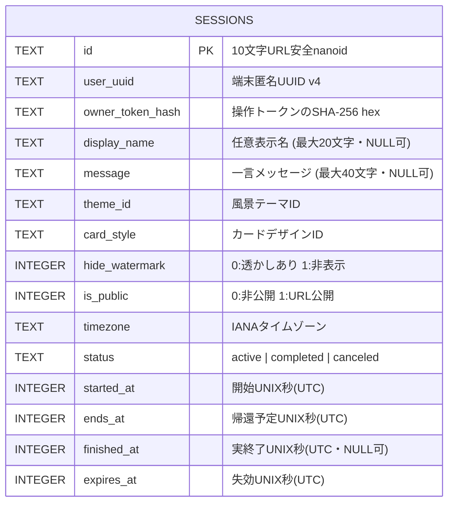

# データベース・永続化設計書

本ドキュメントはサーバー側（Turso / SQLite）およびクライアント側（iOS SwiftData / Keychain / UserDefaults）の永続化スキーマ正本です。

---

## 1. サーバー側：Turso（libSQL / SQLite）設計

### 1.1 ER 図



### 1.2 完全 DDL（正本）

MVP では単一テーブル `sessions` のみで構成し、結合コストとデータ保持リスクを最小化します。

```sql
CREATE TABLE IF NOT EXISTS sessions (
    id TEXT PRIMARY KEY,                              -- 10文字URL安全nanoid (例: "k9x2m7p4q8", 約60bitエントロピー)
    user_uuid TEXT NOT NULL,                          -- 端末生成の匿名UUID v4
    owner_token_hash TEXT NOT NULL,                   -- セッション操作用トークン(32byte hex)のSHA-256 hex
    display_name TEXT,                                -- 任意の表示名 (最大20文字, NULL可)
    message TEXT,                                     -- 一言メッセージ (最大40文字, NULL可)
    theme_id TEXT NOT NULL,                           -- 'misty_mountain' | 'rainy_bamboo' | 'moonlit_lake' | 'dawn_shrine'
    card_style TEXT NOT NULL DEFAULT 'washi_classic', -- 'washi_classic' | 'sumi_night' | 'indigo_mist'
    hide_watermark INTEGER NOT NULL DEFAULT 0,        -- 0: 透かし表示, 1: 非表示 (Proサーバー検証済)
    is_public INTEGER NOT NULL DEFAULT 0,             -- 0: 非公開(同時人数集計のみ), 1: 不在証明URL公開
    timezone TEXT NOT NULL DEFAULT 'Asia/Tokyo',      -- IANAタイムゾーン文字列
    status TEXT NOT NULL,                             -- 'active' | 'completed' | 'canceled'
    started_at INTEGER NOT NULL,                      -- UNIX秒(UTC)
    ends_at INTEGER NOT NULL,                         -- 帰還予定UNIX秒(UTC)
    finished_at INTEGER,                              -- 実際の終了UNIX秒(UTC)
    expires_at INTEGER NOT NULL                       -- 自動失効UNIX秒(UTC; started_at + 86400)
);

CREATE INDEX IF NOT EXISTS idx_sessions_active ON sessions (status, ends_at);
CREATE INDEX IF NOT EXISTS idx_sessions_user_active ON sessions (user_uuid, status);
CREATE INDEX IF NOT EXISTS idx_sessions_expires_at ON sessions (expires_at);
```

### 1.3 インデックス設計と主要クエリ実行計画

| 用途 | 実行 SQL クエリ | 利用インデックス |
| :--- | :--- | :--- |
| **同時雲隠れ人数集計** | `SELECT COUNT(*) FROM sessions WHERE status = 'active' AND ends_at > ?1;` | `idx_sessions_active (status, ends_at)` で Range Scan |
| **既存 active の自動キャンセル** | `UPDATE sessions SET status = 'canceled', finished_at = ?1 WHERE user_uuid = ?2 AND status = 'active';` | `idx_sessions_user_active (user_uuid, status)` で Point/Range Look-up |
| **不在証明詳細・OGP 取得** | `SELECT * FROM sessions WHERE id = ?1 LIMIT 1;` | `PRIMARY KEY (id)` で O(log N) |
| **期限切れクリーンアップ** | `DELETE FROM sessions WHERE expires_at < ?1;` | `idx_sessions_expires_at (expires_at)` で Range Delete |

> **Turso 無料枠への配慮**: `GET /api/v1/stats/active` は Cloudflare で 30 秒キャッシュされるため、1 回の集計クエリで多数のクライアント応答を賄い、Turso の Row Read 消費を最小限に抑えます。

### 1.4 マイグレーション運用方針
- マイグレーション SQL は `services/api/migrations/` 配下に連番ファイル（例: `0001_init.sql`）として管理する。
- 管理用テーブル `_schema_migrations (version TEXT PRIMARY KEY, applied_at INTEGER NOT NULL)` を設け、起動時またはデプロイ前ステップで未適用マイグレーションのみ冪等に適用する（複数コンテナ起動時の競合を避けるため、MVP では CI/CD デプロイ手順内で `turso db shell` または専用コマンドで 1 回適用する方式を推奨）。

### 1.5 TTL 失効と物理削除ポリシー
1. セッション作成時、`expires_at = started_at + 86400`（発行 24 時間後）を設定。
2. `expires_at <= now` となった時点で `/s/{id}` および `/ogp/{id}.png` は即座に `410 Gone` を返し、データにアクセスさせない。
3. 毎日 1 回（JST 04:00 頃）、Cloud Scheduler が `POST /internal/cleanup` を実行し、`expires_at < (now - 86400)`（発行から 48 時間経過後）のレコードを物理削除する。これにより個人データ・発言テキストがサーバー上に永続蓄積しない。

---

## 2. クライアント側：iOS 永続化設計

### 2.1 SwiftData モデル（`DetoxSessionRecord`）

端末ローカルには無料/有料を問わず**全期間の記録を保持**します（無料ユーザーには UI 上で直近 7 日間のみ表示し、Pro 加入時に過去の記録が即座に解放されるようにするため）。

```swift
import Foundation
import SwiftData

@Model
final class DetoxSessionRecord {
    @Attribute(.unique) var localID: UUID
    var remoteID: String?               // サーバー発行の10文字nanoid (オフライン時はnil)
    var ownerToken: String?             // 完了通知用トークン (finish送信完了後にnilへクリア)
    var isPublic: Bool                  // 不在証明URLを発行したか
    var purposeID: String               // 'rest' | 'reading' | 'sleep' | 'focus' | 'walk' | 'custom'
    var displayName: String?            // 任意表示名
    var customMessage: String?          // 一言メッセージ
    var themeID: String                 // 'misty_mountain' | 'rainy_bamboo' | 'moonlit_lake' | 'dawn_shrine'
    var soundID: String                 // 'none' | 'rain' | 'night_wind' | 'bonfire'
    var cardStyle: String               // 'washi_classic' | 'sumi_night' | 'indigo_mist'
    var plannedDurationSeconds: Int     // 予定秒数 (900..43200)
    var actualDurationSeconds: Int      // 実経過秒数
    var statusRaw: String               // 'active' | 'gracePeriod' | 'completed' | 'canceled' | 'interrupted'
    var startedAt: Date
    var plannedEndsAt: Date
    var finishedAt: Date?
    var needsRemoteFinishSync: Bool     // オフライン等で/finish未送信の場合 true

    init(...) { ... }
}
```

### 2.2 7 日間無料制限クエリ設計（雲隠れ帳）
- **累計サマリー（無料/Pro 共通表示）**: 全 `statusRaw == "completed"` レコードの `actualDurationSeconds` 合計と件数を取得。
- **詳細リスト（無料時）**: `let cutoff = Calendar.current.date(byAdding: .day, value: -7, to: Date())!` として `startedAt >= cutoff` で `FetchDescriptor` をフィルタリング。
- **ロック件数バッジ**: `startedAt < cutoff` のレコード件数のみ `fetchCount` で取得し、「これまでの記録（{N} 件）は隠者プランで閲覧できます」と表示。

### 2.3 Keychain 保存項目
機密性・再インストール/識別維持の観点から、`user_uuid` のみ Keychain に保存します。

| Key (`kSecAttrAccount`) | Service (`kSecAttrService`) | 値 | Accessibility 属性 |
| :--- | :--- | :--- | :--- |
| `kumogakure.anonymous_user_uuid` | `app.kumogakure.ios` | UUID v4 文字列（小文字） | `kSecAttrAccessibleAfterFirstUnlockThisDeviceOnly` |

- `ThisDeviceOnly` を使うことで、他端末への暗号化なし復元によるトークン衝突を防ぎつつ、同一端末での一時的なバックグラウンド実行中も読み取り可能にします（課金状態は Apple ID に紐づくため機種変更時は「購入を復元」で引き継ぎ）。

### 2.4 `UserDefaults`（非機密 UI 設定）
`@AppStorage` 等で前回の選択状態を保持し、起動 3 秒開始を支えます。

| Key | 型 | デフォルト値 | 用途 |
| :--- | :--- | :--- | :--- |
| `pref_duration_minutes` | `Int` | `30` | 前回選んだタイマー分数 |
| `pref_purpose_id` | `String` | `"rest"` | 前回選んだ目的プリセット |
| `pref_theme_id` | `String` | `"misty_mountain"` | 前回選んだ風景テーマ |
| `pref_sound_id` | `String` | `"rain"` | 前回選んだ環境音 |
| `pref_card_style` | `String` | `"washi_classic"` | 前回選んだカードデザイン |
| `pref_display_name` | `String` | `""` | 任意表示名の記憶 |
| `pref_keep_screen_on` | `Bool` | `false` | 画面オン維持トグル前回状態 |
| `pref_morning_target_minutes` | `Int` | `420`（07:00） | 「明日の朝まで」プリセットの目標朝時刻（0:00 からの経過分数、許容 `300...600` = `05:00`〜`10:00`） |
| `has_dismissed_pro_banner` | `Bool` | `false` | 3 回完了後の Pro バナー閉鎖フラグ |
