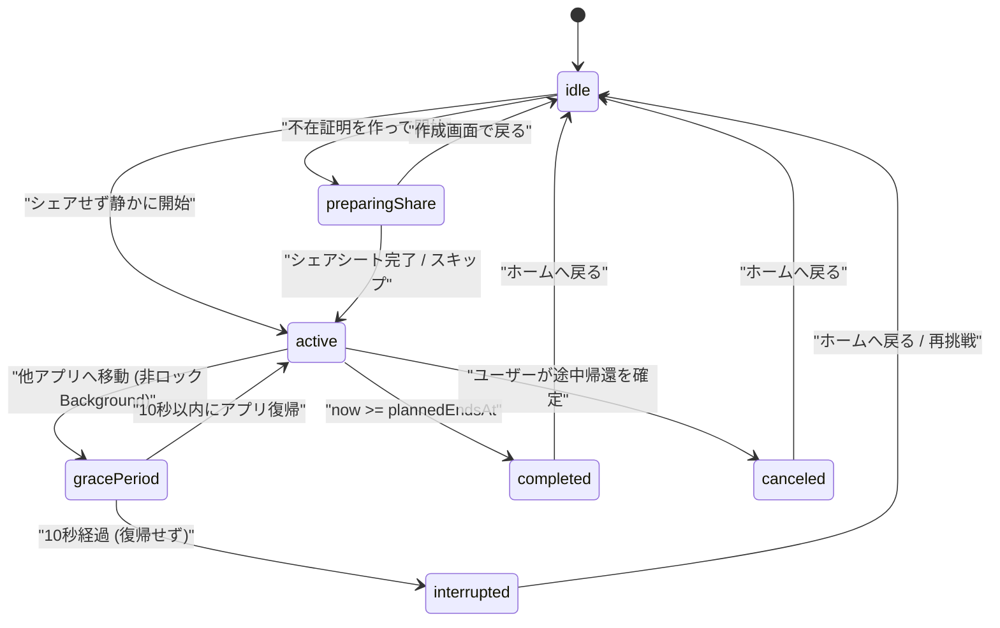

# iOS アプリ詳細実装仕様書（SwiftUI / iOS 17.0+）

本ドキュメントは `apps/ios` の実装ガイドライン（正本）です。UI 仕様は [../02-design/ux-and-screens.md](../02-design/ux-and-screens.md)、永続化は [database-design.md](database-design.md)、通信契約は [api-spec.md](api-spec.md) を参照してください。

---

## 1. ディレクトリ・モジュール構成

```text
apps/ios/Kumogakure/
├── App/
│   ├── AppConfig.swift                   # API Base URL, Bundle ID, RevenueCat Key/Product ID の単一管理
│   ├── KumogakureApp.swift               # エントリポイント、SwiftDataコンテナ、RevenueCat初期化、タスクキル復帰判定
│   └── RootView.swift                    # 状態に応じた画面ルーティング (S-01..S-08)
├── Features/
│   ├── Home/                             # S-01 ホーム画面・設定チップ・カスタム時間ピッカー
│   ├── Share/                            # S-02 不在証明作成・UIActivityViewControllerラッパー
│   ├── Detox/                            # S-03 雲隠れ中画面・FogView・途中帰還確認
│   ├── Result/                           # S-04 帰還完了画面 & S-05 途中帰還/離脱リセット画面
│   ├── History/                          # S-06 雲隠れ帳・Swift Charts統計・7日制限バナー
│   ├── Paywall/                          # S-07 隠者プランPaywall
│   └── Settings/                         # S-08 設定画面
├── Core/
│   ├── Domain/                           # Catalog (theme_id/sound_id/card_style/purpose_id), SessionStatus
│   ├── Timer/                            # DetoxSessionStore, DetoxTimerEngine, AppLifecycleMonitor
│   ├── Audio/                            # AmbientAudioManager (AVAudioSession + AVAudioPlayer)
│   ├── Notification/                     # NotificationScheduler (完了通知 & 10秒猶予通知)
│   ├── Storage/                          # SwiftData DetoxSessionRecord, KeychainHelper, OfflineFinishQueue
│   ├── Network/                          # KumogakureAPIClient (URLSession async/await)
│   └── Billing/                          # SubscriptionManager (RevenueCat SDK ラッパー)
├── DesignSystem/                         # カラー、タイポ、ボタン、カードView (ImageRenderer共用)
└── Resources/
    ├── Assets.xcassets                   # 風景画像 4種、アイコン、和紋
    ├── Sounds/                           # rain.m4a, night_wind.m4a, bonfire.m4a
    └── Info.plist
```

---

## 2. セッション状態機械（State Machine）

`DetoxSessionStore`（`@Observable`, `@MainActor`）が以下の状態遷移を一元管理します。



---

## 3. 主要コンポーネント詳細設計

### 3.1 `DetoxTimerEngine`（絶対時刻ベース計測）
- 内部状態として `startedAt: Date` と `plannedEndsAt: Date` を保持する。
- 1 秒ごとに `Task` または `Timer.publish(every: 1, on: .main, in: .common)` で画面表示を更新し、毎回 `remaining = max(0, plannedEndsAt.timeIntervalSince(clock.now))` を計算する。
- `clock` を Protocol（`ClockProviding`）で注入できるようにし、単体テストで時間経過を瞬時に再現できるようにする。
- `remaining <= 0` に達した瞬間、自動的に `completeSession()` を発火させる。

### 3.2 `AppLifecycleMonitor`（画面ロック vs 他アプリ離脱検知）
ADR-002 に基づき、以下のアルゴリズムで実装します。

1. 監視対象状態は `state == .active` のときのみ有効（`preparingShare` 等では何もしない）。
2. `scenePhase` が `.background` に変化した時刻を記録し、**1.5 秒の判定ディレイ** を開始する。
3. 1.5 秒以内に `UIApplication.protectedDataWillBecomeUnavailableNotification` を受信した場合:
   - **「画面ロック（正当な放置）」と確定**。ディレイをキャンセルし、`active` 状態を維持する（タイマー継続）。
4. 1.5 秒経過しても上記通知が来なかった場合:
   - **「他アプリまたはホーム画面への遷移」と判定**し、`gracePeriod` へ移行する。
   - 即座に `NotificationScheduler.scheduleGraceWarningNotification()`（1 秒後発火）をトリガーし、現在時刻 + 10 秒を `graceDeadline` として保存する。
   - **10 秒監視**: バックグラウンドでの実行時間（`beginBackgroundTask` 利用）または次回フォアグラウンド復帰時の `now >= graceDeadline` 比較により 10 秒超過を判定する。
5. `.active` に復帰した際の判定:
   - まず `now >= plannedEndsAt` であれば（ロック中でも）即座に `completed` とする（ただし既に 10 秒猶予超過で `interrupted` 確定済みなら `interrupted` 優先）。
   - `gracePeriod` 中かつ `now < graceDeadline` であれば `active` へ戻し、警告通知の保留分をキャンセルする。
   - `gracePeriod` 中かつ `now >= graceDeadline` であれば `interrupted` へ確定し S-05 へ遷移する。

### 3.3 `AmbientAudioManager`（バックグラウンド環境音再生）
- **無音時の非起動原則（App Review 2.5.4 対策）**: `sound_id == "none"` またはミュート時は、`AVAudioSession.setActive(true)` および無音トラック再生を**一切実行しない**。
- **Audio Session 設定**:
  - 再生開始時に `AVAudioSession.sharedInstance().setCategory(.playback, mode: .default, options: [.mixWithOthers])`（※単独集中したい場合は `.mixWithOthers` 外す判断も可だが他通知音を邪魔しない設計を推奨）→ `setActive(true)`。
- **ループ再生**:
  - `AVAudioPlayer(contentsOf: url)` に `numberOfLoops = -1` を設定してギャップレス再生。
- **フェード制御**: `setVolume(0, fadeDuration: 1.5)` で完了・キャンセル時に滑らかに停止し、`setActive(false, options: .notifyOthersOnDeactivation)` でセッション解放する。
- **割り込み対応**: `AVAudioSession.interruptionNotification`（着信・通話等）を受け、`began` で一時停止、`ended`（`.shouldResume`）で自動再開する。

### 3.4 `ShareCardRenderer`（`ImageRenderer` + `UIActivityViewController`）
- SwiftUI 専用 View（`AbsenceCardSnapshotView`）に対し `ImageRenderer(content: view)` を実行（`renderer.scale = 1.0` で正確に出力ピクセル `1080x1080` または `1080x1920` を生成）。
- `@MainActor` で実行し、`renderer.uiImage` を取得。
- シェア時は `UIActivityViewController` を SwiftUI `UIViewControllerRepresentable` で提示し、`completionWithItemsHandler` でシート閉鎖を確実に検知してから S-03 へ遷移する。

### 3.5 `NotificationScheduler`（ローカル通知）
- **完了通知**: セッション開始時に `UNTimeIntervalNotificationTrigger(timeInterval: remainingSeconds, repeats: false)` で「霧が晴れました。おかえりなさい。」を予約する。途中帰還・離脱確定時は即座に `removePendingNotificationRequests` でキャンセルする。
- **通知権限リクエストタイミング**: 初回アプリ起動時ではなく、**初めて「雲隠れを始める」をタップする直前（またはオンボーディング的 1 ダイアログ）** にコンテキストを説明してリクエストし、拒否されてもアプリ利用をブロックしない。

### 3.6 `KumogakureAPIClient` & `OfflineFinishQueue`
- `URLSession` の `timeoutIntervalForRequest = 5.0` 秒に設定し、通信不良時にユーザーを長く待たせない。
- セッション終了時（`completed` / `canceled` / `interrupted`）、`DetoxSessionRecord.remoteID` と `ownerToken` が存在すれば `POST /api/v1/sessions/{id}/finish` を送信する。
- 成功したら `needsRemoteFinishSync = false`、`ownerToken = nil` に更新。
- 失敗したら `needsRemoteFinishSync = true` を SwiftData に保存し、次回アプリ起動時およびフォアグラウンド復帰時にバックグラウンドで再送する（`expires_at` 超過後なら再送せず破棄）。

### 3.7 `SubscriptionManager`（RevenueCat ラッパー）
- `AppConfig` に定義した RevenueCat Public Key・Entitlement ID（`hermit_pro`）・Product ID を参照する（開発中は仮 Bundle ID `app.kumogakure.ios` とし、Week 5 の App Store Connect 登録時に `AppConfig` 含め最終確定する）。
- 起動時に `KeychainHelper.getOrCreateAnonymousUserUUID()` を取得し、`Purchases.configure(withAPIKey: ..., appUserID: userUUID)` を実行。
- `customerInfoStream` を監視し、`isPro = customerInfo.entitlements["hermit_pro"]?.isActive == true` を `@Observable` プロパティとしてアプリ全体へリアクティブに反映する。

### 3.8 `FogView` & 画面オン維持（`isIdleTimerDisabled`）
- **`FogView`（霧晴れレイヤー）**: `DetoxTimerEngine` の `progress`（`0.0...1.0`）を受け取り、背景風景のブラー減衰・明度調整・多層霧の透過アニメーションを描画する（30fps 上限の `TimelineView`、Reduce Motion 時はクロスフェードのみ）。
- **画面オン維持トグル**: S-03 画面の「画面を点けたまま」トグル状態およびセッション進行状態に連動して `UIApplication.shared.isIdleTimerDisabled` を切り替える。完了・途中帰還・離脱確定・ホーム復帰時は必ず `isIdleTimerDisabled = false` へ戻し、バッテリー消耗や画面焼き付きを防止する。

---

## 4. アプリ強制終了（タスクキル）からの復帰処理

ユーザーが雲隠れ中にマルチタスク画面からアプリを上スワイプで強制終了（タスクキル）し、あとから再起動した場合の挙動を定義します。

1. `KumogakureApp` 起動時、SwiftData から `statusRaw == "active" || statusRaw == "gracePeriod"` の最新レコードを検索。
2. 該当レコードが存在する場合:
   - `now >= record.plannedEndsAt` かつ `statusRaw == "active"`: **完了（`completed`）扱い** とし、S-04 帰還完了画面を表示（環境音は停止済みなので静かにねぎらう）。
   - `now < record.plannedEndsAt`: タスクキルは「アプリ離脱」と同じ扱いとするか継続するか検討対象だが、Forest 型の誠実性に基づき **`interrupted`（離脱リセット）** とし、S-05 画面を表示した上で `canceled` をサーバー同期する（※補足: バックグラウンドで OS によりメモリ回収されたケースとの厳密区別は困難なため、`statusRaw == "active"` かつ画面ロック中ならアプリ起動後に復帰時間を加味する代替案も考慮するが、MVP は明確さを優先し **ローカル保存された `lastBackgroundWasScreenLock` フラグが `true` なら継続・復帰、それ以外は `interrupted`** とする）。

---

## 5. `Info.plist` 必須設定

| Key | 値 | 用途 |
| :--- | :--- | :--- |
| `UIBackgroundModes` | `["audio"]` | 画面ロック中の環境音シームレスループ再生 |
| `ITSAppUsesNonExemptEncryption` | `false` | App Store Connect 輸出規制申告の簡略化（標準 HTTPS のみ使用） |
| `CFBundleDisplayName` | `雲隠れ` | ホーム画面アイコン下表示名 |

---

## 6. テスト方針（XCTest）

Protocol DI により外部依存（時計、ライフサイクル、API、RevenueCat）を差し替え、シミュレータで自動テストを実行します。

1. **状態機械・タイマーテスト**:
   - `ClockProviding` モックで 15 分〜12 時間の経過・完了判定をテスト。
   - 「明日の朝まで」の境界時刻およびユーザー設定朝の時刻（`05:00`〜`10:00`、デフォルト `07:00`、720 分上限クランプ）計算テスト。
   - `AppLifecycleMonitor`: `.background` 後 0.2s で画面ロック通知が来た場合は継続、来ない場合は 10 秒猶予→9 秒復帰で継続→11 秒復帰で `interrupted` になることを検証。
2. **SwiftData・7 日制限テスト**:
   - 8 日前のデータと 2 日前のデータを投入し、無料プランフィルタとロック件数取得が正確であることを検証。
3. **API クライアント・オフライン再送テスト**:
   - `URLProtocol` スタブを使い、500 / タイムアウト時に `needsRemoteFinishSync = true` が残り、次回復帰でリトライ成功後に `ownerToken` がクリアされることを検証。
4. **Week 1〜4 開発中のローカル課金検証**:
   - Apple Developer Program 登録完了（Week 4〜5）までは、Xcode の **StoreKit Configuration File（`.storekit`）** を用い、年額 7 日間無料トライアル・月額課金・購入復元・期限切れフォールバックをシミュレータおよび無料 Personal Team 実機でローカル検証する。
