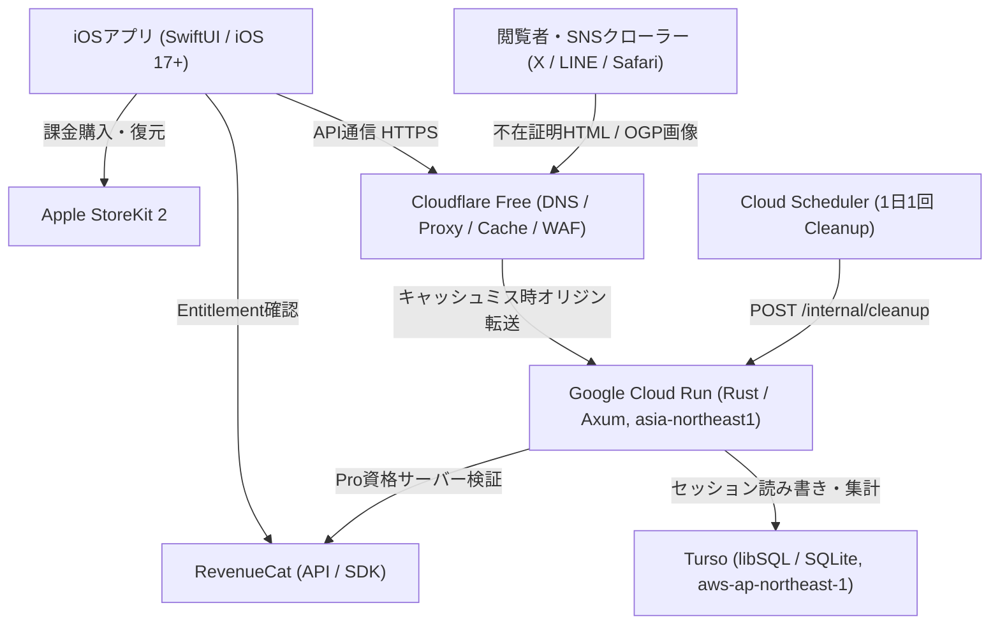
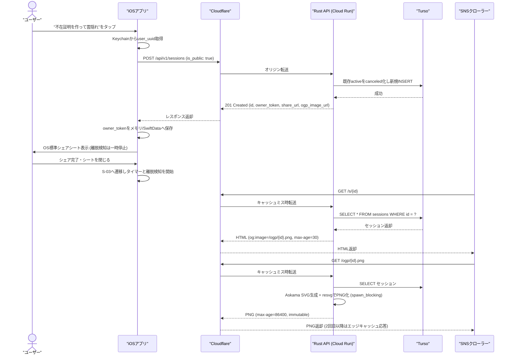
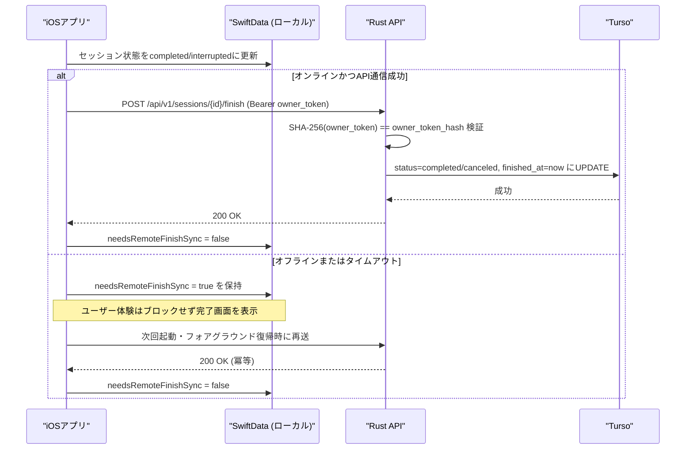
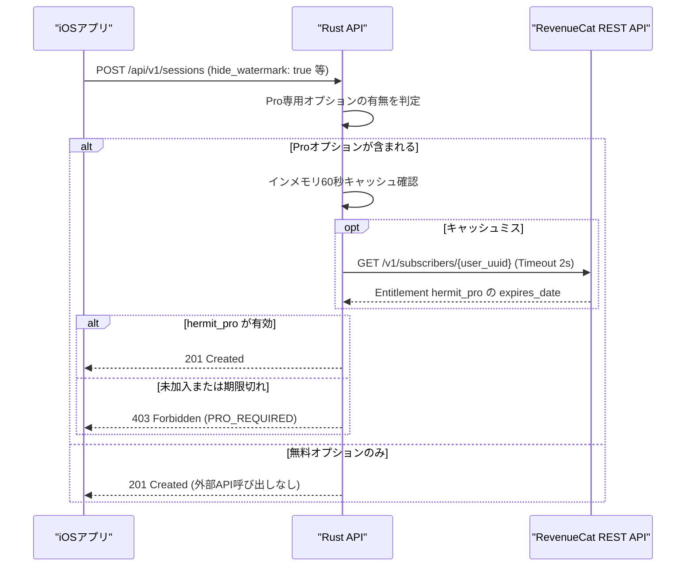

# システムアーキテクチャ設計書

## 1. 全体構成図（単一オリジン・最小構成）

個人開発における **固定費ほぼ 0 円・高速コールドスタート・SNS バズ耐性** を実現するため、Cloudflare Proxy の背後に単一の Cloud Run サービス（Rust / Axum）を配置する単一オリジン構成を採用します。



---

## 2. 主要シーケンス図

### 2.1 不在証明付き開始〜SNS シェア〜クローラー OGP 取得



### 2.2 完了・途中終了・オフライン時再送フロー



### 2.3 Pro 資格のサーバー検証フロー



---

## 3. モノレポ構成案と責務分界

```text
Kumogakure/
├── README.md
├── AGENTS.md
├── docs/                      # 設計ドキュメント一式 (本ディレクトリ)
├── apps/
│   └── ios/                   # SwiftUI iOS アプリ (iOS 17.0+)
│       ├── Kumogakure.xcodeproj
│       ├── Kumogakure/        # アプリソースコード
│       └── KumogakureTests/   # XCTest ユニット・状態機械テスト
├── services/
│   └── api/                   # Rust (Axum) 単一バイナリ
│       ├── Cargo.toml
│       ├── Dockerfile
│       ├── assets/fonts/      # Shippori Mincho 等 OGP 用フォント
│       ├── templates/         # Askama HTML & SVG テンプレート
│       ├── migrations/        # Turso / SQLite SQL マイグレーション
│       └── src/
└── infra/
    ├── cloudflare/            # キャッシュ・WAF ルール定義メモ / IaC
    ├── gcp/                   # Cloud Run / Scheduler / Secret Manager 構築スクリプト
    └── github/                # CI/CD ワークフローテンプレート
```

### コンポーネント責務分界

| コンポーネント | 担う責務 | 担わない責務（割り切り） |
| :--- | :--- | :--- |
| **iOS アプリ** | タイマー精密計測、霧アニメーション、環境音再生、離脱検知、ローカル履歴保存（SwiftData）、SNS カード描画、RevenueCat 購入 | OGP 画像の Web 配信、他ユーザーの同時人数集計、Web ページホスティング |
| **Rust API** | セッション ID 発行、不在証明 HTML、動的 OGP PNG 生成、同時人数集計、Pro サーバー検証、法務静的 HTML、期限切れ掃除 | ユーザーアカウント・パスワード管理、履歴の恒久バックアップ、通知送信（APNs） |
| **Turso** | 24 時間以内のアクティブ/公開セッション永続化 | 長期分析データウェアハウス、画像バイナリ保存 |
| **Cloudflare** | SSL 終端、OGP/集計キャッシュ、IP ベースレート制限・Bot 保護 | 動的 HTML の生成、認証チェック |
| **RevenueCat** | App Store レシート検証、購読状態管理、REST 照会 | アプリ機能フラグの UI 制御 |

---

## 4. セキュリティ & UGC 脅威モデル

| 脅威カテゴリ | 攻撃シナリオ・リスク | 採用した対策（正本仕様） |
| :--- | :--- | :--- |
| **ID 推測・総当たり** | `/s/{id}` や `/ogp/{id}.png` を連番スキャンして他人の発言を盗み見る | 10 文字 URL 安全 nanoid（約 60bit エントロピー）を採用し推測困難化。さらに `is_public = 0` のセッションは `/s/{id}` と `/ogp/{id}.png` で必ず `404` を返す。 |
| **セッション乗っ取り** | 他人の `id` や漏洩した `user_uuid` を使って勝手に `/finish` で終了させる | 発行時に 32byte ランダム `owner_token` を生成し SHA-256 ハッシュのみ DB 保存。`/finish` 時は `Bearer owner_token` の定数時間比較を必須化。 |
| **XSS / SVG インジェクション** | `display_name` や `message` に `<script>` や `<svg onload=...>`・不正 XML 属性を混入 | ①書記素単位で文字数制限（20/40文字）②制御文字除去 ③Askama の HTML/XML 自動エスケープ強制 ④厳格な CSP ヘッダ付与。 |
| **不適切投稿・スパム（UGC）** | 差別表現・卑猥語・スパム URL を含む不在証明 URL を生成して拡散 | ①サーバー側 NG ワード＆URL スキーム簡易フィルタ ②無料プランはプリセット文言のみに制限 ③`/s/{id}` に `noindex, nofollow` 付与 ④Web ページ下部に通報導線を設置し、管理者手順で即時削除＆CF キャッシュパージ可能にする。 |
| **OGP 生成による DoS / 課金爆発** | 存在しない ID や大量の並列 `/ogp/{id}.png` リクエストで Cloud Run メモリ枯渇・課金増加 | ①DB に存在する公開セッションのみ描画（不存在は即 `404`）②Cloudflare エッジキャッシュ（`max-age=86400, immutable`）③Cloudflare WAF レート制限 ④Cloud Run `max-instances=3` 上限設定 ⑤`spawn_blocking` 並列上限セマフォ。 |
| **Pro 機能クライアント偽装** | リバースエンジニアリングで `hide_watermark: true` を直接 POST する | サーバー側で `hermit_pro` Entitlement を RevenueCat REST API で検証し、未課金なら `403 PRO_REQUIRED` を返す。 |
| **個人情報の漏洩・検索露出** | ユーザーの休息履歴や匿名 UUID が外部検索エンジンや DB に残存する | DB にメールアドレス・端末名等を一切保存せず、`expires_at`（24 時間）経過後は `410 Gone` としたうえで日次ジョブで物理削除する。 |
