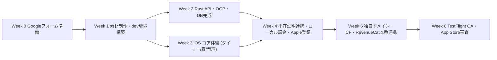

# 開発ロードマップ・WBS（Week 0 〜 Week 6）

企画書の 6 週間計画をベースに、**初期費用ゼロ先行**（Apple Developer 登録と独自ドメイン取得を Week 4〜5 へ後ろ倒し）の方針へ最適化した WBS と完了条件（DoD）です。

---

## 1. クリティカルパス全体図

---

## 2. 週次 WBS と完了条件（Definition of Done）

### Week 0: 無料事前セットアップ
有料登録は行わず、無料の窓口整備のみ先に完了させます。

| ID | タスク | 担当 | 完了条件（DoD） |
| :--- | :--- | :--- | :--- |
| **W0-1** | Google フォーム 2 種作成（①お問い合わせ・不具合報告用、② `/s/{id}` からの UGC 通報用：`session_id` 事前入力 URL 取得） | オーナー | フォーム送信テストおよびメール通知受信確認完了 |

---

### Week 1: 環境構築・素材制作・`dev` インフラ構築
| ID | タスク | 担当 | 完了条件（DoD） |
| :--- | :--- | :--- | :--- |
| **W1-1** | モノレポ初期化（`apps/ios`, `services/api`, `infra`） | 開発 | Git リポジトリ構成作成、`.gitignore` 整備 |
| **W1-2** | 画像生成 AI で風景画像 4 種（1290x2796）制作・トーン統一・600KB 以下最適化 | デザイン/オーナー | 4 枚の HEIC/JPEG が生成・権利記録付きで配置 |
| **W1-3** | CC0・商用利用可フリー音源から環境音 3 種（`rain`, `night_wind`, `bonfire`）ループ編集（-18 LUFS） | デザイン/オーナー | 継ぎ目ノイズなしの `.m4a` 3 ファイルと出典メモ配置 |
| **W1-4** | OGP 用和文フォント 2 種（**Shippori Mincho** ＋ **Noto Serif JP**）ダウンロード | 開発 | 両フォント（`ShipporiMincho-Regular.ttf` / `NotoSerifJP-Regular.otf`）と SIL OFL ライセンスを配置 |
| **W1-5** | Turso DB 作成（`kumogakure-dev` 東京リージョン）＋ `0001_init.sql` 適用 | Infra | `turso db shell` で `sessions` テーブル作成確認 |
| **W1-6** | GCP プロジェクト・Artifact Registry・Secret Manager・Cloud Run `dev` 初期構築（`min-instances=0`, `*.run.app`） | Infra | Cloud Run デフォルト URL で `/health` 応答確認 |

---

### Week 2: Rust（Axum）バックエンド実装・`dev` デプロイ
| ID | タスク | 担当 | 完了条件（DoD） |
| :--- | :--- | :--- | :--- |
| **W2-1** | ドメイン層（10 文字 nanoid / `owner_token` 生成、書記素サニタイズ、NG ワード、タイムゾーン変換） | Backend | ユニットテスト全パス |
| **W2-2** | セッション API（`POST /sessions`, `POST /finish`, `GET /stats/active`） | Backend | インメモリ DB 統合テスト全パス |
| **W2-3** | RevenueCat REST API 検証クライアント（60 秒キャッシュ + Fail-Open） | Backend | モック HTTP テストで `403 PRO_REQUIRED` と許容を確認 |
| **W2-4** | 不在証明 HTML（`/s/{id}`：Google フォーム通報リンク埋込）＋ 法務静的ページ ＋ 410/404 テンプレート | Backend | XSS エスケープ検証、`noindex` ヘッダ確認 |
| **W2-5** | 動的 OGP 生成（`ogp_card.svg` + Shippori Mincho / Noto Serif JP + `resvg` + `spawn_blocking` + セマフォ） | Backend | 1200x630 PNG 出力確認、各種漢字の欠けがないこと |
| **W2-6** | `/internal/cleanup` 実装 + GitHub Actions CI + Cloud Scheduler 設定 | Backend/Infra | `dev` 環境（`*.run.app`）へ自動デプロイ・疎通完了 |

---

### Week 3: iOS アプリ（MVP コア体験）実装
シミュレータおよび無料 Personal Team 実機でローカル完結コア体験を作り込みます。

| ID | タスク | 担当 | 完了条件（DoD） |
| :--- | :--- | :--- | :--- |
| **W3-1** | Xcode プロジェクト作成（iOS 17+）、`AppConfig`・デザインシステム（色・タイポ・コンポーネント）実装 | iOS | Preview 上で和モダン基調 UI 確認 |
| **W3-2** | `KeychainHelper`（匿名 UUID）＋ SwiftData `DetoxSessionRecord` ＋ `UserDefaults`（朝目標時刻 05:00〜10:00 含む）実装 | iOS | 再起動しても同一 UUID 維持・履歴保存確認 |
| **W3-3** | `DetoxTimerEngine` ＋ `AppLifecycleMonitor`（画面ロック許容・10 秒猶予検知） | iOS | Protocol DI による XCTest 境界テスト全パス |
| **W3-4** | `FogView`（多層霧アニメ + Reduce Motion 対応）＋ ハプティクス実装 | iOS | 実機 30fps 以上で滑らかに霧が晴れること |
| **W3-5** | `AmbientAudioManager`（`.playback` ループ・無音時非起動・フェードアウト・着信割り込み） | iOS | マナーモード＆画面ロック中の再生確認 |
| **W3-6** | 画面 S-01（ホーム）、S-03（雲隠れ中）、S-04（完了）、S-05（途中/リセット）実装 | iOS | 一連のローカルデトックスフロー完結 |

---

### Week 4: iOS 不在証明連携・ローカル課金実装・Apple 登録着手
| ID | タスク | 担当 | 完了条件（DoD） |
| :--- | :--- | :--- | :--- |
| **W4-1** | `KumogakureAPIClient`（`dev` Cloud Run URL 接続）＋ `OfflineFinishQueue`（起動時自動再送） | iOS | 機内モード→復帰で `/finish` 再送成功 |
| **W4-2** | S-02（不在証明作成）＋ `ShareCardRenderer`（1:1 / 9:16）＋ シェアシート競合回避 | iOS | LINE / X / IG ストーリーへの画像＆URL 共有確認 |
| **W4-3** | S-06（雲隠れ帳：7 日制限ロジック・Swift Charts 統計）＋ S-08（設定画面・朝時刻変更・Google フォーム導線） | iOS | 7 日超ロック表示と累計サマリー動作 |
| **W4-4** | S-07（Paywall）＋ Xcode **`.storekit` ローカル設定ファイル**（年額 7 日間無料トライアル含む）での課金フロー検証 | iOS | ローカル StoreKit で購入・復元・7 日制限解除確認 |
| **W4-5** | 同時雲隠れ人数（0 人代替コピー含む）＋ タスクキル復帰判定実装 | iOS | 強制終了後の再起動復帰挙動確認 |
| **W4-6** | **Apple Developer Program 登録 ＆ Small Business Program（15%）申請開始**（審査リードタイム対策） | オーナー | Developer Portal ログイン可、15% 申請送信済 |

---

### Week 5: ドメイン/CF 接続・RevenueCat 本番連携・ストア素材作成
| ID | タスク | 担当 | 完了条件（DoD） |
| :--- | :--- | :--- | :--- |
| **W5-1** | 独自ドメイン取得（`kumogakure.app` 第一候補）＋ Cloudflare DNS/Cache/WAF 設定 ＋ `BASE_URL` / `AppConfig` 更新 | Infra/オーナー | `https://<domain>/s/{id}` と `/ogp/{id}.png` でキャッシュ動作 |
| **W5-2** | Bundle ID 最終確定・App Store Connect 課金商品作成（年額 7 日無料トライアル付）＋ RevenueCat 本番連携 | iOS/オーナー | Sandbox 実機で月額/年額購入・復元・サーバー 403/200 疎通成功 |
| **W5-3** | 法務ドラフト（[../05-release/legal-drafts.md](../05-release/legal-drafts.md)）に Google フォーム等を記入し確定版 HTML 反映 | オーナー/Backend | `/legal/privacy` と `/legal/terms` が本番 URL で閲覧可 |
| **W5-4** | アプリアイコン制作 ＋ App Store スクリーンショット・ASO 原稿作成 | デザイン/オーナー | 必須サイズ一式を App Store Connect 登録完了 |
| **W5-5** | Build in Public 用デモ動画撮影・X 告知準備 | オーナー | 霧が晴れる 15 秒動画クリップ作成 |

---

### Week 6: TestFlight QA・`prod` 本番構築・リリース
| ID | タスク | 担当 | 完了条件（DoD） |
| :--- | :--- | :--- | :--- |
| **W6-1** | 本番環境（`prod` Cloud Run / Turso / Cloud Scheduler / GCP Budget アラート）構築 | Infra | `prod` で `/health?deep=1` OK、予算アラート設定済 |
| **W6-2** | TestFlight 配信・[../05-release/app-store-checklist.md](../05-release/app-store-checklist.md) 全実機 QA（X/LINE OGP 展開含む）実施 | 全員 | 全チェック項目パス、重大バグ 0 件 |
| **W6-3** | App Store 審査提出（2.5.4 / 1.2 / 3.1.2 対策の審査メモ添付） | オーナー | 審査提出完了 → 承認（Ready for Sale） |
| **W6-4** | リリース公開 ＋ X（Build in Public）告知ポスト | オーナー | 一般公開確認、初期アクセス・ログ監視 |

---

## 3. 主要リスクと緩和策

| リスク | 発生確度 | 緩和策 |
| :--- | :--- | :--- |
| **Apple Small Business Program の承認遅れ** | 中 | Week 4 段階で申請を前倒しして実施（仮に初週だけ 30% 手数料になってもリリース自体には支障なし）。 |
| **Apple Review でのリジェクト（2.5.4 / 4.2 / 3.1.2）** | 中 | 審査提出前にチェックリストで「無音時 AudioSession 非起動」「Paywall 7 日間無料表記・復元ボタン」「UGC 通報」を完全確認し、審査メモを丁寧に記述。 |
| **和文フォント・画像/音声素材の権利不備** | 低 | Week 1 で SIL OFL フォント（Shippori Mincho / Noto Serif JP）と CC0/商用可素材のみ採用し、出典・生成記録をリポジトリに保存。 |
| **画面ロック判定がパスコードなし実機で効かない** | 低 | ヘルプ・設定で「画面オン維持トグル」の活用を案内。Phase 2 で Screen Time API へ拡張。 |

---

## 4. リリース後・Phase 2 着手判断基準

リリース後 2〜4 週間は新機能開発を急がず、以下を計測してから Phase 2（Screen Time API・Live Activities・スケジュール予約・月間カレンダー・iCloud 同期）へ進みます。

1. **クラッシュフリー率 99.5% 以上** かつ **サーバー障害・高額課金ゼロ** で安定運用できていること。
2. **不在証明シェア率 20〜25% 以上** または **セッション完了率 60% 以上** が確認でき、コア体験の PMF 兆候があること。
3. ユーザーフィードバック（X や Google フォーム）で「他アプリブロック（Screen Time）」または「ロック画面表示（Live Activities）」の要望が明確に上位であること。
